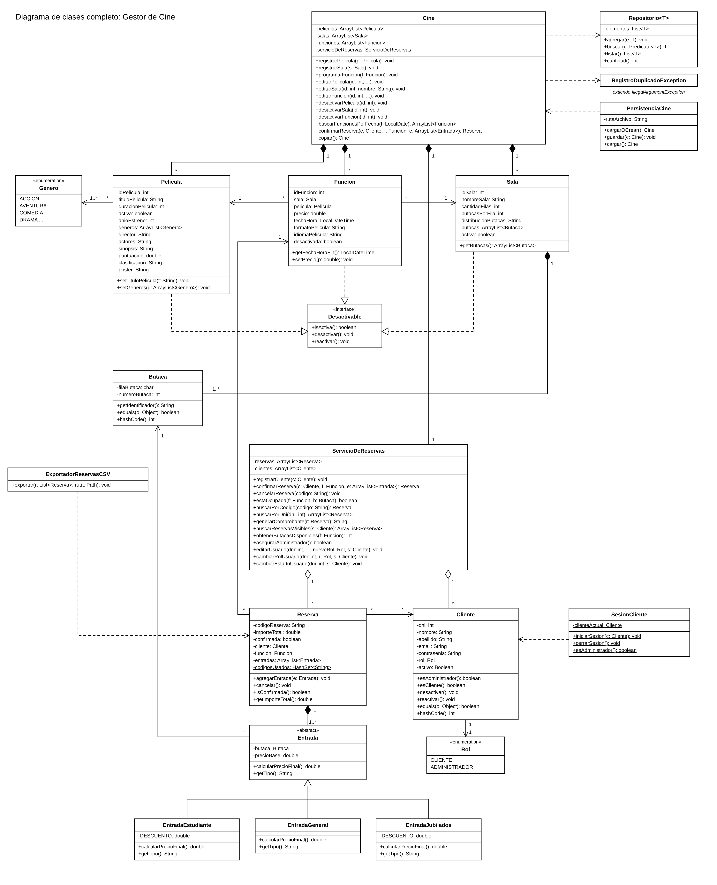

<div align="center">

# Gestor de Cine

**Sistema de reservas para un cine, en Java y JavaFX**


Trabajo Final de Programación II · Tecnicatura Universitaria en Programación

<br>

**Docentes**<br>
Ing. Daniel Benítez · Cristian Corsaro

**Alumnos**<br>
Gimena Díaz · Rodrigo Arregin

<br>

[Funcionalidades](#funcionalidades) · [Instalación](#instalación-y-ejecución) · [Usuarios](#carga-inicial-y-usuarios) · [Conceptos](#conceptos-aplicados) · [Diagrama](#diagrama-de-clases) · [Estructura](#estructura-del-proyecto)

</div>

---

## Funcionalidades

| Área | Qué permite |
|---|---|
| **Cartelera** | Ver las películas con filtros y el detalle de cada una |
| **Reservas** | Elegir una o varias butacas por función; las ya ocupadas se rechazan. Cada cliente ve sus reservas, confirmadas y canceladas, en "Mis reservas" |
| **Entradas** | Tres tipos con precio propio: general, estudiante (20 % off) y jubilados (45 % off) |
| **Cancelación** | Cancelar una reserva libera las butacas para volver a usarlas |
| **Administración** | Alta y edición de películas, salas y funciones, sin funciones superpuestas en una misma sala |
| **Baja lógica** | Películas, salas y funciones se desactivan sin perder su historial |
| **Usuarios y roles** | Administrador y cliente, cada uno con su propio menú. El administrador puede editar, desactivar y reactivar cuentas sin borrar sus reservas |
| **Exportación** | Reservas a CSV y comprobante de cada reserva |
| **Persistencia** | Todo se guarda por serialización y se recupera al reiniciar |

---

## Instalación y ejecución

### Requisitos

| Componente | Detalle |
|---|---|
| JDK | 25 |
| JavaFX SDK | 27.0.1, instalado y configurado en NetBeans. La carpeta depende de cada computadora |
| IDE | NetBeans (proyecto Ant) |

El proyecto se ejecuta con estas opciones de la JVM, donde `<carpeta del SDK>` es la ubicación del JavaFX en cada computadora:

```
--module-path "<carpeta del SDK>\lib" --add-modules javafx.controls,javafx.fxml
```

> **Si el JavaFX está en otra carpeta:** en NetBeans, click derecho sobre el proyecto, **Properties > Libraries**, y corregir la ruta de los `.jar` de JavaFX (base, controls, fxml, graphics). Lo mismo en **Properties > Run > VM Options**.

### Pasos

1. Clonar o descargar el repositorio.
2. En NetBeans: **File > Open Project** y elegir la carpeta `gestorDeCine`.
3. Ejecutar con **Run** (`F6`).

La clase principal es `gestordecine.GestorDeCine`.

---

## Archivos de datos

| Archivo / carpeta | Para qué sirve |
|---|---|
| `cine_app.dat` | Guarda películas, salas, funciones, clientes y reservas. Si no existe, el programa lo crea al abrir. |
| `posters/` | Imágenes de las películas. |

---

## Carga inicial y usuarios

El `cine_app.dat` del repositorio ya trae datos de demostración (salas, películas, funciones y reservas), por lo que la aplicación se puede probar de inmediato.

Credenciales de demostración:

| Rol | DNI | Contraseña |
|---|---|---|
| Administrador | `1` | `admin1234` |
| Cliente | se registra desde la pantalla de acceso | la que elija al registrarse |

> **Aclaración:** son credenciales de prueba para evaluar el trabajo. Las contraseñas se guardan sin cifrar, algo aceptable para este alcance académico pero que no se haría en un sistema real.

> **Para empezar de cero:** si se borra `cine_app.dat`, el programa arranca sin datos y crea únicamente el usuario administrador.

<details>
<summary><b>Si el archivo de datos está dañado</b></summary>

<br>

Si `cine_app.dat` no se puede leer, el programa muestra un cartel con la ruta del archivo y se cierra **sin modificarlo**. Para empezar de cero alcanza con borrar ese archivo.

</details>

---

## Conceptos aplicados

| Concepto | Aplicación |
|---|---|
| Programación orientada a objetos | Modelado de películas, salas, funciones, clientes y reservas |
| Herencia y polimorfismo | Clase abstracta `Entrada` con `EntradaGeneral`, `EntradaEstudiante` y `EntradaJubilados` |
| Interfaces | `Desactivable`, implementada por `Pelicula`, `Sala` y `Funcion` |
| Genéricos | `Repositorio<T>`, usado desde `Cine` |
| Colecciones | `ArrayList` y `HashSet` para películas, salas, funciones, clientes y reservas |
| Excepciones | Validaciones y `RegistroDuplicadoException` |
| Persistencia | Serialización de objetos en `cine_app.dat` |
| Fechas | `LocalDateTime` y `LocalDate` de `java.time` |
| Interfaces gráficas | JavaFX con archivos FXML y un controlador por pantalla |

---

## Diagrama de clases

Diagrama completo del modelo: entradas, películas, salas, funciones, reservas, clientes y el repositorio genérico.



El diagrama editable (UMLet) está en [`docs/diagrama_clases_completo.uxf`](docs/diagrama_clases_completo.uxf).

---

## Estructura del proyecto

```
gestorDeCine/
├── src/gestordecine/
│   ├── (modelo)         Cine, Pelicula, Sala, Funcion, Butaca, Genero,
│   │                    Reserva, ServicioDeReservas, Cliente, Rol,
│   │                    Entrada (abstracta), EntradaGeneral,
│   │                    EntradaEstudiante, EntradaJubilados,
│   │                    Desactivable, RegistroDuplicadoException,
│   │                    PersistenciaCine, GestorDeCine (main)
│   ├── controladores/   controladores JavaFX de las pantallas
│   ├── vistas/          pantallas .fxml (cartelera, películas, salas,
│   │                    funciones, reservas, formularios)
│   ├── estilos/         estilos.css
│   ├── sesion/          sesión del usuario y pantalla de acceso
│   ├── misreservas/     pantalla "Mis reservas" del cliente
│   ├── usuarios/        administración de usuarios
│   ├── persistencia/    exportación de reservas a CSV
│   └── repositorios/    repositorio genérico Repositorio<T>
├── capturas/            capturas de las pantallas principales
├── evidencias/          casos de verificación con su evidencia
├── docs/                informe y diagrama de clases
├── posters/             imágenes de las películas
├── cine_app.dat         datos guardados
└── nbproject/           configuración de NetBeans
```
